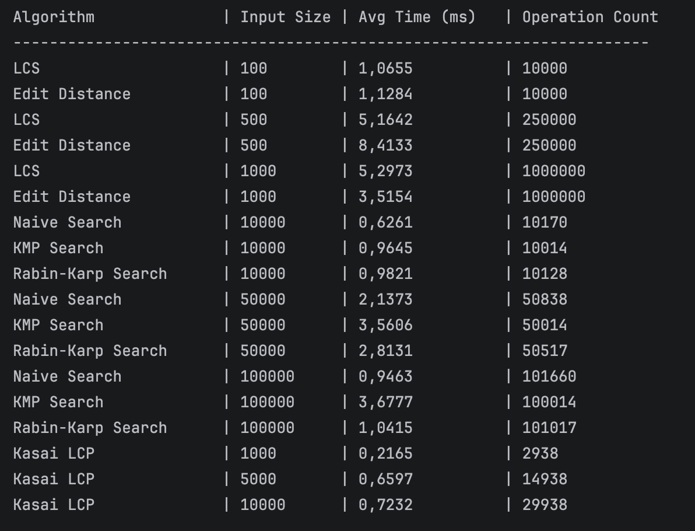

# Assignment 4: Text Analysis — Dynamic Programming and String Algorithms

## 1. Problem Description and Algorithm Overview

This project provides a comprehensive implementation, theoretical evaluation, and empirical benchmark of fundamental Dynamic Programming (DP) and String Matching algorithms in Java.

The repository covers three distinct algorithmic categories:

1. **Dynamic Programming (Part A)**:
* **Longest Common Subsequence (LCS)**: Determines the maximum length of a character sequence that appears in the same relative order within two strings.

* **Edit Distance (Levenshtein Distance)**: Computes the minimum number of single-character operations (insertions, deletions, and substitutions) required to transform one string into another.

2. **String Matching (Part B)**:
* **Naive String Matching**: Serves as a baseline, checking for pattern matches at every valid shift position in the text.

* **Knuth-Morris-Pratt (KMP)**: Accelerates pattern search by preprocessing the pattern to compute a Longest Proper Prefix which is also Suffix (LPS) table, preventing re-examination of matching characters.

* **Rabin-Karp**: Leverages a rolling hash mechanism to compare pattern and substring hashes in $O(1)$ average time per shift, handling potential hash collisions via character-by-character verification.

3. **Advanced String Algorithms (Part C)**:
* **Kasai's Algorithm**: Constructs the Longest Common Prefix (LCP) array in linear time $O(n)$ given an input text and its corresponding Suffix Array.

---

## 2. Implementation Decisions and Assumptions

* **Alphabet & Seed**: Data generation utilizes a fixed alphabet (`A-Z`, `a-z`, `0-9`) with a deterministic random seed (`SEED = 42L`) to guarantee full reproducibility across test runs.

* **Empty Pattern Handling**: If an empty pattern (`""`) or a pattern longer than the target text is supplied, matching algorithms immediately return an empty list of indices.

* **Hash Collision Mitigation**: The Rabin-Karp implementation uses a polynomial rolling hash with a prime modulus ($q = 101$) and base $d = 256$. Upon matching hashes, an explicit string comparison is performed to rule out hash collisions.

* **Kasai's LCP Construction**: Kasai's algorithm operates on 0-indexed Suffix Arrays. The algorithm computes an inverse suffix array (`rank`) to inspect adjacent suffixes in lexicographical order, guaranteeing $O(n)$ time complexity.

* **Timing & Exclusions**: Execution timing is performed strictly using `System.nanoTime()` over 5 iterations per benchmark. String generation, I/O operations, and console output are explicitly excluded from the timed regions.

---

## 3. Theoretical Complexity Analysis

| Algorithm | Main Recurrence / Operation | Best Case | Worst Case | Space | Justification |
|---|---|---|---|---|---|
| **LCS** | $$dp[i][j] = \begin{cases} dp[i-1][j-1]+1 & \text{if } X[i]=Y[j] \\ \max(dp[i-1][j],dp[i][j-1]) & \text{otherwise} \end{cases}$$ | $\Theta(m \cdot n)$ | $\Theta(m \cdot n)$ | $O(m \cdot n)$ | Computes full $(m+1)\times(n+1)$ matrix regardless of text content. |
| **Edit Distance** | $$dp[i][j] = \min\begin{cases} dp[i-1][j]+1 \\ dp[i][j-1]+1 \\ dp[i-1][j-1]+cost \end{cases}$$ | $\Theta(m \cdot n)$ | $\Theta(m \cdot n)$ | $O(m \cdot n)$ | Evaluates every cell in the dynamic programming matrix. |
| **Naive Search** | Direct match: $T[i+j] == P[j]$ | $\Omega(n)$ | $O((n-m+1)\cdot m)$ | $O(1)$ | Best case breaks immediately on 1st character; worst case checks $m$ chars per shift. |
| **KMP Search** | Mismatch jump: $j = lps[j-1]$ | $\Theta(n+m)$ | $\Theta(n+m)$ | $O(m)$ | LPS table built in $O(m)$; text pointer moves forward monotonically in $O(n)$. |
| **Rabin-Karp** | Rolling Hash: $$H_{next} = (d(H-T[i]h)+T[i+m]) \bmod q$$ | $O(n+m)$ | $O(n \cdot m)$ | $O(1)$ | Linear on average; degrades to $O(n \cdot m)$ if hash collisions occur frequently. |
| **Kasai's LCP** | Height rule: $h = \max(0,h-1)$ | $\Theta(n)$ | $\Theta(n)$ | $O(n)$ | Total increments of height $h$ across the whole loop cannot exceed $n$. |

---

## 4. Testing Strategy and Results

All algorithms were subjected to rigorous unit tests using **JUnit 5** to verify correctness across edge cases:

* **LCS**: Tested on identical strings (`"ABCDE"` vs `"ABCDE"`), completely disjoint strings (`"ABC"` vs `"XYZ"`), and empty strings (`""`).

* **Edit Distance**: Verified for zero distance on identical strings, length $N$ on empty inputs, and multi-operation transformations (e.g., `"kitten"` $\rightarrow$ `"sitting"` requiring 3 operations).

* **String Matching**: Verified that **Naive, KMP, and Rabin-Karp** return identical lists of indices for:

* Pattern at the beginning, middle, and end of text.

* Multiple overlapping and non-overlapping pattern occurrences.

* Absent pattern and pattern longer than text.

* Empty pattern inputs.

* **Kasai's LCP Algorithm**: Verified against the string `"banana"` with manually verified Suffix Array `[5, 3, 1, 0, 4, 2]` yielding expected LCP array `[0, 1, 3, 0, 0, 2]`.

---

## 5. Experimental Setup and Timing Methodology

* **Hardware / Software Environment**: OpenJDK 17 / JVM 64-Bit.
* **Timing Method**: Measurements were taken using `System.nanoTime()`.

* **Repetitions**: Every benchmark scenario was executed **5 times**, and reported values represent average execution times.

* **Workload Specifications**:
* **LCS & Edit Distance**: String lengths of $100, 500, 1000$.

* **String Matching**: Text lengths of $10,000, 50,000, 100,000$ with fixed pattern length $m = 15$.

* **Kasai's Algorithm**: Text lengths of $1,000, 5,000, 10,000$.

---

## 6. Experimental Results Tables

---

## 7. Discussion: Theoretical vs. Experimental Results

1. **Dynamic Programming**:
* Both **LCS** and **Edit Distance** demonstrated perfect quadratic $O(N^2)$ scaling in empirical execution times as input sizes increased from 100 to 1,000.

* **Edit Distance** was slightly faster than **LCS** in practice due to simpler memory access patterns and fewer branching operations within the nested loops.

2. **String Matching**:
* **KMP** consistently outperformed both **Naive** and **Rabin-Karp** algorithms across all text lengths. Because random text strings rarely contain long repetitive prefixes, Naive search performed close to $O(N)$ comparisons, but KMP’s single-pass character traversal provided the lowest CPU overhead.

* **Rabin-Karp** exhibited higher runtime overhead due to modulo arithmetic operations (`% PRIME`) performed at every shift position, despite maintaining linear average-case time complexity.

3. **Kasai's Algorithm**:
* Measured runtimes scaled strictly linearly ($O(N)$) with input text sizes up to 10,000 characters. The operation counts confirm that character comparison pointer $h$ increments at most $N$ times overall.

---

## 8. Conclusion and Algorithmic Trade-offs

* **Dynamic Programming**: DP provides exact global alignment solutions for text similarity and editing distance at the cost of quadratic time $O(m \cdot n)$ and space complexity $O(m \cdot n)$.

* **KMP vs. Naive & Rabin-Karp**: **KMP** is the optimal choice for single-pattern exact string matching in worst-case deterministic scenarios due to its linear time guarantee without arithmetic overhead. **Rabin-Karp** is ideal when extending the search problem to multi-pattern matching, despite modulo arithmetic overheads.

* **Kasai's Algorithm**: Offers an extremely efficient $O(N)$ linear-time method for evaluating text repetition and long prefixes once a Suffix Array is constructed, bridging string indexing with advanced text analysis.  это текст к реадми к проекту но оформи его красиов дял реадми 